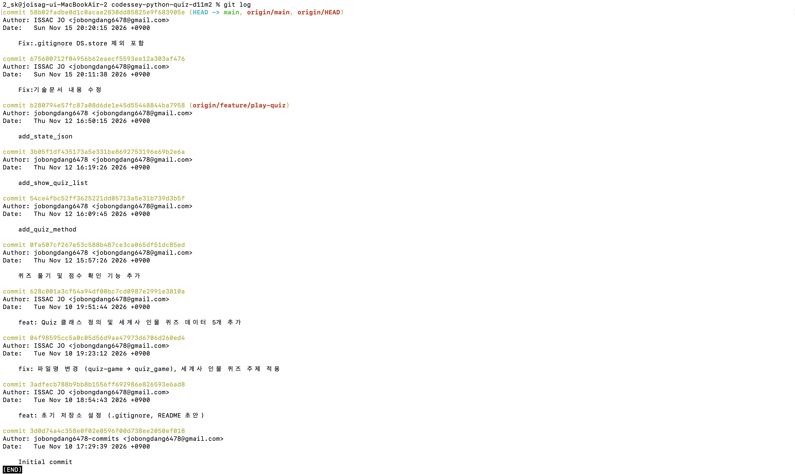
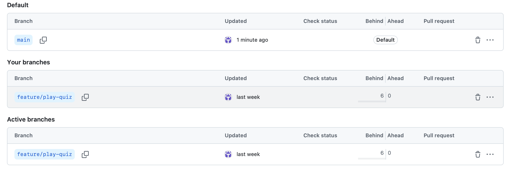
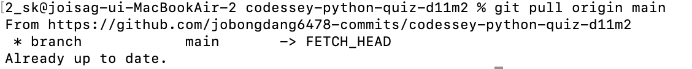

# Python Quiz Game (세계사 인물 퀴즈)


## 프로젝트 개요

Python과 GitHub을 활용하여 제작한 콘솔 기반의 역사 퀴즈 게임입니다.

별도의 외부 라이브러리 없이 파이썬 표준 라이브러리(`json`, `os`, `shutil`)만으로 동작하며, 퀴즈 풀이, 문제 추가, 목록 조회, 최고 점수 및 등급 확인, 자동 저장·백업 및 안전 종료 기능을 제공합니다.


## 퀴즈 주제와 선정 이유

세계사 인물 맞추기 퀴즈를 주제로 선정하였습니다. "역사를 잊은 민족에게 미래는 없다"는 말처럼, 평소 역사를 좋아하는 입장에서 게임을 통해 재미있게 역사 인물을 학습하고자 기획했습니다.


---


## 실행 방법


### 사전 요구 사항

* Python 3.7 이상 (외부 패키지 설치 불필요)


### 실행 명령어

터미널(또는 명령 프롬프트)에서 `quiz_game.py` 파일이 위치한 디렉터리로 이동한 뒤 아래 명령어를 실행합니다.

```bash
python quiz_game.py
```


### 실행 흐름

1. 프로그램이 시작되면 현재 폴더에서 `state.json` 파일을 탐색합니다(`load_state()`).
2. 파일이 존재하면 저장된 퀴즈 목록과 최고 점수를 불러옵니다.
3. 파일이 없으면 기본 내장된 세계사 퀴즈 5문제로 초기화합니다.
4. 파일이 손상(`JSONDecodeError`, `KeyError`)된 경우 `recover_from_backup()`을 호출하여, 정상 백업 파일(`state.json.bak`)에서 복구하거나 기본 데이터로 초기화할 수 있는 선택지를 제공합니다.
5. 메인 메뉴(1~5번)가 출력되며, 숫자를 입력해 원하는 기능을 실행합니다.
6. 최고 점수 경신, 새 퀴즈 추가, 정상 종료(`5번`), 또는 강제 종료(`Ctrl+C` / `EOF`) 시 `state.json`에 상태를 안전하게 저장하고 백업 파일(`state.json.bak`)을 자동 갱신합니다.


---


## 기능 목록

프로그램은 사용자 메뉴 기능(5종)과 내부 시스템 기능(4종)으로 구성됩니다.

| 구분 | 메뉴 번호 / 메서드 | 기능명 | 상세 설명 |
| :--- | :--- | :--- | :--- |
| **사용자 메뉴** | `1` / `play_quiz()` | **퀴즈 풀기** | 등록된 모든 4지선다 퀴즈를 순차적으로 출제하고 정답 여부를 즉시 판별합니다. 종료 후 총점을 계산하며, 최고 점수 경신 시 자동으로 상태를 저장합니다. |
| **사용자 메뉴** | `2` / `add_quiz()` | **퀴즈 추가** | 새로운 문제 텍스트, 4개의 선택지, 정답 번호(1~4)를 입력받아 퀴즈 목록에 추가하고 `state.json`에 즉시 저장합니다. |
| **사용자 메뉴** | `3` / `show_quiz_list()` | **퀴즈 목록 조회** | 현재 시스템에 등록된 전체 퀴즈의 번호, 문제 내용, 정답 번호 및 정답 텍스트를 출력합니다. |
| **사용자 메뉴** | `4` / `show_score()` | **점수 및 등급 확인** | 현재까지 기록된 최고 점수와 전체 문제 수 대비 정답률에 따른 등급(`역사 마스터`, `역사 박사`, `역사 학도`, `역사 입문자`)을 출력합니다. |
| **사용자 메뉴** | `5` / `run()` 종료 분기 | **게임 종료** | 현재까지의 최고 점수와 퀴즈 목록을 `state.json`에 최종 저장한 뒤 프로그램을 안전하게 종료합니다. |
| **시스템 기능** | `input_number()` | **입력값 유효성 검증** | 공백 입력, 숫자가 아닌 문자열 입력(`ValueError`), 허용 범위를 벗어난 숫자 입력을 차단하고 재입력을 유도합니다. |
| **시스템 기능** | `save_state()` / `load_state()` | **데이터 영속성 및 자동 백업** | `Quiz` 객체를 직렬화(`to_dict`)해 `state.json`에 저장하고, 정상 저장 시 `state.json.bak` 백업을 자동 생성합니다. 쓰기 오류(`OSError`)도 안전하게 처리합니다. |
| **시스템 기능** | `recover_from_backup()` | **손상 파일 복구 옵션** | `state.json` 파일이 손상되었을 때 백업 파일(`state.json.bak`) 존재 여부를 확인하여, 사용자가 **백업 복구** 또는 **기본 데이터 초기화** 중 선택할 수 있게 합니다. |
| **시스템 기능** | `run()` 예외 처리 | **강제 종료 안전 처리** | 실행 도중 `Ctrl+C`(`KeyboardInterrupt`) 또는 `EOF`(`EOFError`) 입력이 발생해도 비정상 종료되지 않고, 현재 상태를 자동 저장한 뒤 안전하게 종료합니다. |


---


## 아키텍처 및 객체지향(OOP) 설계 이유

본 프로젝트는 단순 함수 나열 방식 대신 **객체지향 프로그래밍(OOP)**을 적용하여 `Quiz`와 `QuizGame` 두 개의 클래스로 책임을 분리했습니다.

* **`Quiz` 클래스 (데이터 모델 및 단일 문제 책임):** 문제(`question`), 선택지(`choices`), 정답(`answer`) 데이터와 해당 문제를 출력(`show`), 채점(`is_correct`), 직렬화(`to_dict`, `from_dict`)하는 기능을 하나로 캡슐화합니다.
* **`QuizGame` 클래스 (애플리케이션 흐름 및 상태 관리):** 전체 퀴즈 목록(`self.quizzes`), 최고 점수(`self.best_score`), 파일 경로(`state_file`, `backup_file`) 상태를 보유하며, 메뉴 출력, 사용자 입력 검증, 게임 루프, 파일 입출력 및 복구를 총괄합니다.


### 함수 기반 대안 대비 장단점

| 비교 항목 | 객체지향(OOP) 방식 (채택) | 함수 기반(절차적) 방식 |
| :--- | :--- | :--- |
| **상태 관리** | `self.best_score`, `self.quizzes`를 인스턴스 내부에 캡슐화하여 전역 변수 오염을 방지합니다. | 전역 변수(`global`)를 남용하거나 매 함수 호출마다 상태 데이터를 인자로 넘겨야 합니다. |
| **데이터-동작 결합** | 퀴즈 데이터와 채점/출력 로직이 `Quiz` 클래스에 묶여 있어 직관적입니다. | 딕셔너리 구조가 바뀔 때마다 이를 참조하는 모든 함수를 찾아 수정해야 합니다. |
| **유지보수 및 확장성** | 새로운 문제 유형(예: OX 퀴즈) 추가 시 상속 등으로 확장이 용이합니다. | 기능이 늘어날수록 함수 간 의존성이 복잡해져 수정 범위가 커집니다. |
| **단점 (트레이드오프)** | 아주 단순한 스크립트에 비해 초기 보일러플레이트 코드(`__init__`, `self` 등)가 늘어납니다. | 소규모 스크립트에서는 빠르게 작성할 수 있으나 규모가 커지면 관리가 어렵습니다. |


---


## 파일 구조 및 데이터 스키마

```text
python-quiz-game/
 ├── quiz_game.py    # 메인 애플리케이션 소스 코드 (Quiz, QuizGame 클래스 정의 및 실행 루프)
 ├── state.json      # [자동 생성] 최고 점수 및 퀴즈 목록을 보관하는 영구 저장 데이터 파일
 ├── state.json.bak  # [자동 생성] 정상 저장 시 자동 갱신되는 백업 데이터 파일
 ├── README.md       # 프로젝트 개요, 설계, 실행 방법 및 Git 전략을 정리한 기술 문서
 └── .gitignore      # Git 버전 관리에서 제외할 캐시 및 로컬 데이터 파일 목록 설정
```


### 데이터 파일 설명 (`state.json`)

`quizzes`를 **객체 배열(`Array(Object)`)** 중첩 구조로 설계한 이유는, 각 문제의 지문·보기·정답을 하나의 독립된 단위로 묶어 데이터 무결성을 유지하고, 추후 난이도나 카테고리 같은 메타데이터 필드를 추가할 때 기존 구조를 깨지 않고 확장하기 위함입니다.

| 필드명 | 데이터 타입 | 필수 여부 | 설명 및 제약 조건 |
| :--- | :--- | :---: | :--- |
| `best_score` | `Integer` | Y | 사용자가 기록한 역대 최고 점수 (기본값: `0`, 범위: `0` ~ 전체 퀴즈 개수) |
| `quizzes` | `Array(Object)` | Y | 등록된 전체 퀴즈 객체들을 담는 배열 |
| `quizzes[].question` | `String` | Y | 퀴즈의 문제 지문 텍스트 |
| `quizzes[].choices` | `Array(String)` | Y | 4지선다 보기를 담는 문자열 배열 (길이: 4) |
| `quizzes[].answer` | `Integer` | Y | 정답에 해당하는 보기 번호 (1부터 시작하는 인덱스, 허용 범위: `1` ~ `4`) |

```json
{
  "best_score": 4,
  "quizzes": [
    {
      "question": "만유인력의 법칙을 발견한 영국의 과학자는?",
      "choices": [
        "갈릴레오 갈릴레이",
        "아이작 뉴턴",
        "알베르트 아인슈타인",
        "니콜라 테슬라"
      ],
      "answer": 2
    }
  ]
}
```


### JSON 저장 방식의 한계 및 대안

현재 방식(`json.dump` / `json.load`)은 소규모 로컬 앱에 적합하지만, 데이터 규모가 커질 경우 다음과 같은 한계가 존재합니다.

1. **메모리 부담:** `load_state()` 실행 시 파일 전체를 메모리에 한 번에 로드하므로, 수만 개 이상의 퀴즈가 쌓이면 메모리 사용량이 급격히 증가합니다.
2. **쓰기 성능 저하:** 퀴즈 1개만 추가하거나 최고 점수만 갱신해도 `save_state()`가 전체 데이터를 처음부터 다시 덮어쓰므로(Full Rewrite) I/O 비용이 커집니다.
3. **동시성 부족:** 다중 프로세스가 동시에 파일에 접근할 경우 데이터 충돌이 발생할 수 있습니다.

* **대체 방안:**
  * **로컬 환경 확장 시:** 파이썬 내장 `sqlite3`(관계형 DB)를 도입하여 필요한 레코드만 부분 조회·수정하고 트랜잭션으로 데이터 무결성을 보장합니다.
  * **대용량/서비스 확장 시:** PostgreSQL 등의 RDBMS를 사용하거나, 대용량 데이터 처리 시 한 줄씩 스트리밍 처리가 가능한 JSONL(JSON Lines) 또는 이진 직렬화 포맷(MessagePack, Parquet)을 고려할 수 있습니다.


---


## 요구사항 변경 시 수정 지점 및 영향도 매핑

향후 기능 변경이나 요구사항 추가 시 수정해야 할 파일, 메서드 및 영향 범위는 다음과 같습니다.

| 예상 요구사항 변경 | 수정 대상 파일 및 위치 | 영향 범위 및 주의 사항 |
| :--- | :--- | :--- |
| **선택지 개수 변경** (예: 4지선다 → 5지선다) | `quiz_game.py` (`QuizGame.__init__`, `play_quiz`, `add_quiz`) | `input_number`의 `max_val`(4 → 5)과 `add_quiz`의 반복 횟수(`range(1, 5)`) 수정 필요. 기존 `state.json` 데이터 호환성 확인 필요. |
| **문제 메타데이터 추가** (예: 난이도, 카테고리) | `quiz_game.py` (`Quiz.__init__`, `to_dict`, `from_dict`, `add_quiz`, `show_quiz_list`) | `state.json` 스키마 변경. 기존 파일 로드 시 `KeyError` 방지를 위해 `from_dict`에서 `.get()` 기본값 처리 필요. |
| **등급 산정 기준 변경** | `quiz_game.py` (`QuizGame.show_score`) | 점수 비율 조건문(`0.8`, `0.6`)만 수정하면 되며, 데이터 구조나 다른 메서드에 영향 없음. |
| **저장소 교체** (JSON → SQLite 등) | `quiz_game.py` (`QuizGame.save_state`, `load_state`, `recover_from_backup`) | 입출력 및 복구 로직이 메서드로 분리되어 있어, 게임 진행 로직(`play_quiz`, `run` 등)의 수정 없이 저장소만 교체 가능. |
| **저장/백업 파일 경로 변경** | `quiz_game.py` (`QuizGame.__init__`) | `self.state_file`, `self.backup_file` 속성만 수정하면 모든 입출력 및 복구 메서드에 일괄 반영됨. |


---


## Git 협업 및 버전 관리 전략


### 원격 저장소


* **Repository URL:** `https://github.com/jobongdang6478-commits/codessey-python-quiz-d11m2.git' 
=======
* **Repository URL:** `[여기에 GitHub 원격 저장소 URL을 입력하세요]`
>>>>>>> feature/add-code


### 커밋 단위 및 메시지 규칙

변경 사항을 추적하고 롤백하기 쉽도록 **하나의 논리적 작업(기능 추가, 버그 수정, 문서화 등)을 1개의 커밋 단위**로 유지합니다. 커밋 메시지는 Conventional Commits 규칙을 따릅니다.

* **메시지 형식:** `<타입>: <변경 내용 요약>`
* **주요 타입:**
  * `feat`: 새로운 기능 추가 (예: `feat: 퀴즈 추가 기능(add_quiz) 구현`)
  * `fix`: 버그 수정 및 예외 처리 보완 (예: `fix: Ctrl+C 강제 종료 시 자동 저장 및 백업 복구 처리`)
  * `refactor`: 기능 변경 없는 코드 구조 개선 (예: `refactor: 입력 검증 로직을 input_number 메서드로 분리`)
  * `docs`: README 등 문서 작성 및 수정 (예: `docs: 데이터 스키마 및 Git 전략 문서화`)


### 브랜치 전략 및 병합 절차

`main` 브랜치의 안정성을 유지하고 기능 개발 중 발생하는 충돌과 오류를 격리하기 위해 **Feature Branch 전략**을 사용합니다.

1. **브랜치 분리:** `main` 브랜치에서 기능 단위로 새 브랜치를 생성합니다. (예: `feature/add-quiz`, `feature/backup-recovery`)
2. **작업 및 커밋:** 해당 브랜치에서 기능을 구현하고 규칙에 맞게 커밋합니다.
3. **병합(Merge) 절차:** 기능 구현 및 테스트가 완료되면 `main` 브랜치로 이동하여 최신 상태를 동기화(`git pull`)한 뒤, Pull Request(PR) 또는 `git merge`를 통해 병합합니다.
4. **정리:** 병합이 완료된 기능 브랜치는 삭제하여 저장소를 깔끔하게 유지합니다.


### Git 실습 증빙 (로그 및 스크린샷)


* **커밋 히스토리 (10개 이상):** 
* **브랜치 및 병합 기록:**  
* **Clone / Pull 실습 기록:** 
=======
